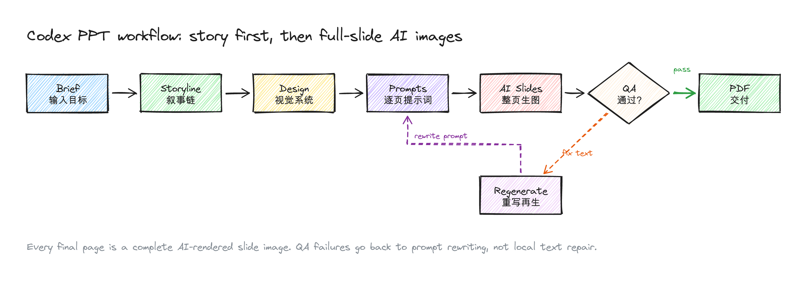
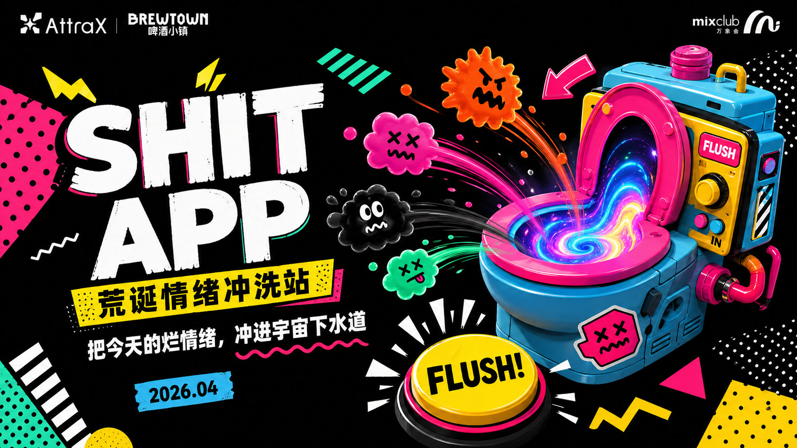
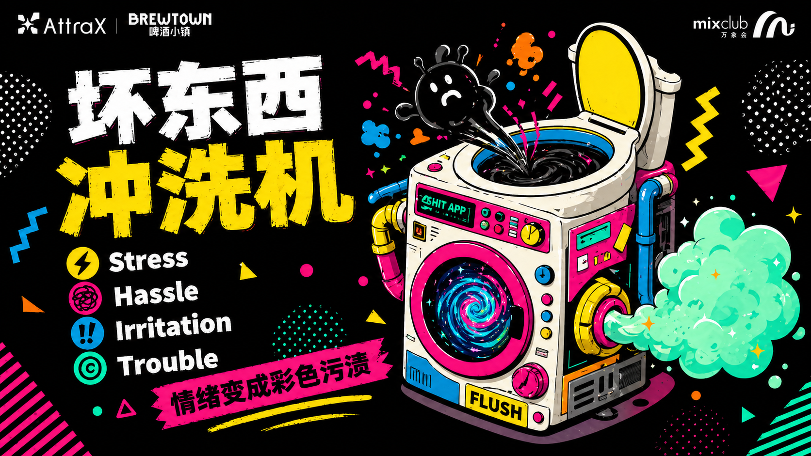
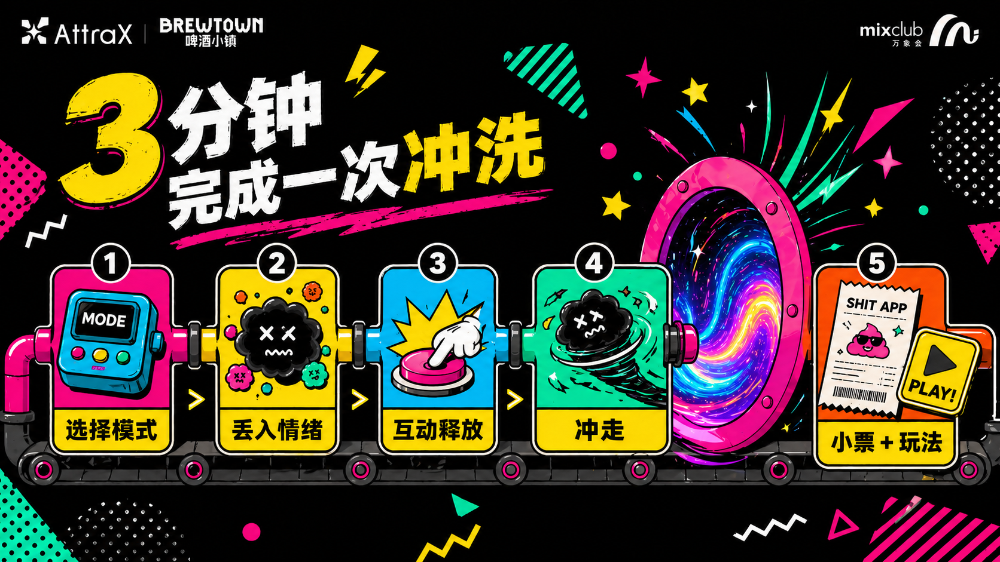
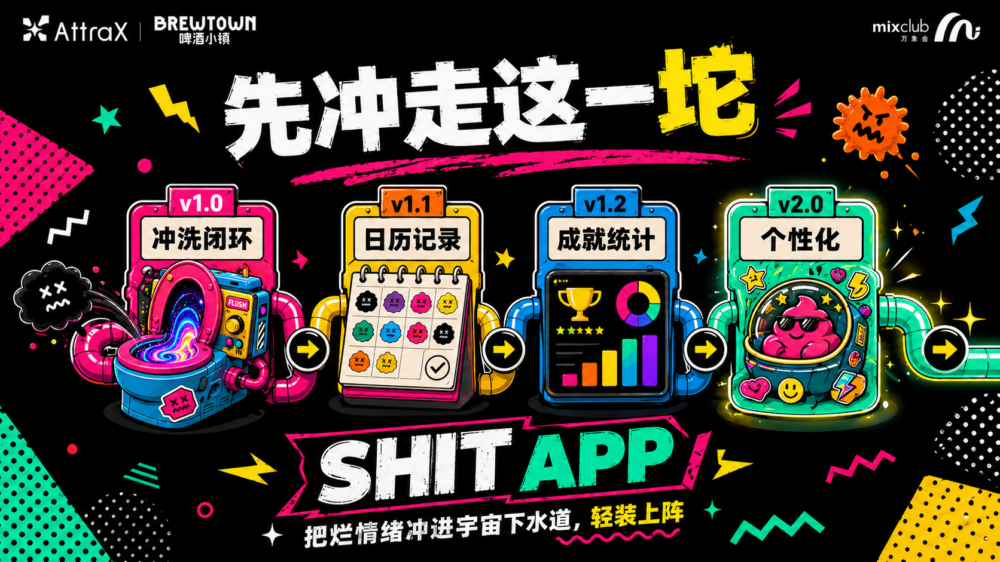

<p align="center">
  
</p>

<p align="center">
  <strong>English</strong> · <a href="./README.zh-CN.md">简体中文</a>
</p>

# Codex PPT

**Codex PPT** is a Codex skill for creating polished 16:9 presentation decks as fully AI-rendered slide images, then compiling the approved pages into a PDF.

It is built for the kind of deck where the story, visual system, slide prompts, QA loop, and final export all matter. Instead of asking an AI model for "some slides", the skill makes Codex behave like a deck producer: plan first, lock the visual language, generate each slide as a complete image, reject weak pages, and only then compile the final deck.

## What It Does

- Turns a topic, outline, report, or rough notes into a complete slide deck plan.
- Writes a brief, storyline, design system, storyboard, and one prompt per slide.
- Generates every final slide as one full-page AI image, including layout, text, charts, and visual objects.
- Forces QA before delivery: aspect ratio, legibility, page order, style consistency, and text accuracy.
- Compiles approved slide images into a strict 16:9 PDF.

## Workflow

<p align="center">
  
</p>

The key idea is simple: **if a slide fails QA, rewrite the prompt and regenerate the whole slide. Do not locally patch text or layout.**

## Install

Clone this repository into your Codex skills directory:

```bash
git clone https://github.com/qybaihe/codex-ppt.git ~/.codex/skills/codex-ppt
```

Then ask Codex:

```text
Use $codex-ppt to make a 10-page product pitch deck about my app idea.
```

## Example Output

The repository includes a real generated deck:

- [Final PDF](./examples/shit-app-memphis-pitch/final/shit-app-memphis-pitch.pdf)
- [Final PPTX](./examples/shit-app-memphis-pitch/final/shit-app-memphis-pitch.pptx)
- [Planning source](./examples/shit-app-memphis-pitch/source/)

### Selected Pages










## Repository Structure

```text
.
├── SKILL.md
├── agents/openai.yaml
├── references/slide-quality-checklist.md
├── scripts/compile_slide_images_to_pdf.py
├── assets/
└── examples/shit-app-memphis-pitch/
```

## How the Skill Thinks

Codex PPT deliberately separates deck production into phases:

1. **Brief**: define audience, objective, page count, tone, source material, and constraints.
2. **Storyline**: create a narrative chain before designing pages.
3. **Design system**: lock palette, type hierarchy, grids, slide variants, image language, and anti-patterns.
4. **Storyboard**: specify each page's role, title, takeaway, copy plan, layout, visual content, and QA risks.
5. **Generation**: create one prompt per slide and generate full-page slide images.
6. **QA**: reject malformed text, style drift, clutter, cropped content, and weak covers or endings.
7. **Export**: compile approved images into a 16:9 PDF.

## Why Image-Based Slides?

Many AI PPT attempts fail because they stitch together generic templates, local text overlays, and inconsistent visuals. This skill takes the opposite route: each slide is one coherent generated poster-like page. That makes it especially useful for pitch decks, concept decks, launch decks, visual reports, mood-driven presentations, and experimental product storytelling.

## License

MIT
